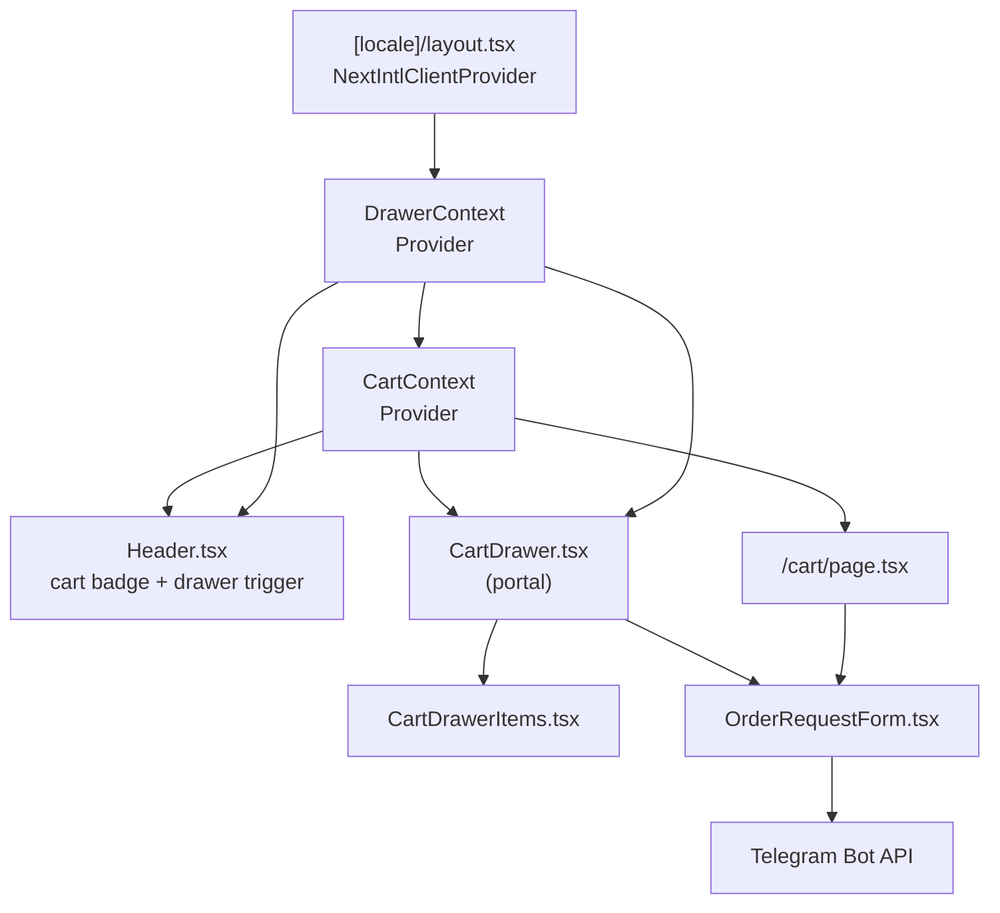

# Design Document — Cart Drawer & Order Request

## Overview

This feature adds a slide-in cart drawer to the Elit Dekor Next.js website. A `DrawerContext` manages the open/closed state and is placed above `CartProvider` in the layout tree. When the drawer opens, it renders via `ReactDOM.createPortal` into `document.body`, displaying the current cart items and an inline `OrderRequestForm`. On valid submission the form sends a formatted Telegram message to both operator chat IDs simultaneously. The same `OrderRequestForm` component is also embedded on the `/cart` page for a consistent checkout experience.

The cart icon in `Header` gains a live item-count badge driven directly by `CartContext.totalItems`.

### Key Design Decisions

| Decision | Rationale |
|---|---|
| `DrawerContext` separate from `CartContext` | Drawer open/close state has no business-logic overlap with cart items. Separation keeps each context's responsibilities narrow and avoids unnecessary re-renders in cart-only consumers. |
| Portal rendering | The drawer must overlay sticky `<header>` and any `z-index` stacking contexts on any page. A portal to `document.body` guarantees correct layering regardless of the current route. |
| Single `OrderRequestForm` component | Avoids duplication of Telegram logic, validation, and translations. Both usage sites (drawer and `/cart` page) receive the same props. |
| `DrawerContext` wraps `CartProvider` in locale layout | Every page under `[locale]` needs both the cart and the drawer. Wrapping at the layout level avoids repeating providers on individual pages. |
| Session storage for cart persistence | Existing behaviour — unchanged. |

---

## Architecture



### Data Flow

1. User adds a product → product card calls `addItem` (CartContext) then `openDrawer` (DrawerContext).
2. User clicks the header cart icon → `openDrawer`.
3. `CartDrawer` is rendered into a portal; it reads `items` from `CartContext` and `isOpen` from `DrawerContext`.
4. User fills `OrderRequestForm` and submits → validation → Telegram API calls → success or error state.
5. On success: `clearCart()` is called; drawer shows success view; closing resets form state.

---

## Components and Interfaces

### `DrawerContext` (`src/context/DrawerContext.tsx`)

```typescript
interface DrawerContextType {
  isOpen: boolean;
  openDrawer: () => void;
  closeDrawer: () => void;
}

export function DrawerProvider({ children }: { children: React.ReactNode }): JSX.Element
export function useDrawer(): DrawerContextType
```

Manages a single `isOpen: boolean` state. Exposes `openDrawer` / `closeDrawer` setters. No dependency on `CartContext`.

---

### `CartDrawer` (`src/components/cart/CartDrawer.tsx`)

Rendered via `ReactDOM.createPortal(panel, document.body)`.

```typescript
// No external props — reads DrawerContext and CartContext internally
export default function CartDrawer(): JSX.Element | null
```

Responsibilities:
- Renders `null` when `isOpen === false` (avoids portalling a hidden element).
- Applies `translate-x-full` → `translate-x-0` CSS transition on open (≤ 300 ms, Tailwind `transition-transform duration-300`).
- Renders a backdrop `<div>` with `bg-black/50` that calls `closeDrawer` on click.
- Adds `overflow-hidden` to `document.body` while open (via `useEffect` cleanup).
- Listens for `keydown Escape` to call `closeDrawer`.
- Width: `w-full sm:w-[420px]`, fixed to right edge with `fixed inset-y-0 right-0`.
- Contains `<CartDrawerItems>` and `<OrderRequestForm>` in a flex-column layout where the item list scrolls independently (`overflow-y-auto flex-1`) and the form sticks at the bottom.
- Shows success view (replacing form content) when `submitted === true`.

---

### `CartDrawerItems` (`src/components/cart/CartDrawerItems.tsx`)

```typescript
// No external props — reads CartContext internally
export default function CartDrawerItems(): JSX.Element
```

- Maps over `items` to render each `CartItem`: 64×64 px image, title, SKU (if present), unit price, quantity controls, remove button.
- Quantity increment: calls `updateQuantity(id, quantity + 1)`.
- Quantity decrement with quantity > 1: calls `updateQuantity(id, quantity - 1)`.
- Quantity decrement with quantity = 1: calls `removeItem(id)` (via `updateQuantity(id, 0)` which CartContext already handles).
- Remove button: calls `removeItem(id)`.
- Empty state: renders translated empty message and `<Link>` to `/catalog/`.

---

### `OrderRequestForm` (`src/components/cart/OrderRequestForm.tsx`)

```typescript
interface OrderRequestFormProps {
  onSuccess?: () => void;  // called after successful Telegram send
}

export default function OrderRequestForm({ onSuccess }: OrderRequestFormProps): JSX.Element
```

Internal state:
```typescript
type FormState = {
  name: string;
  phone: string;
  comment: string;
};
type SubmitState = 'idle' | 'loading' | 'success' | 'error';
```

- Validates: `name` non-empty, `phone` non-empty, `items.length > 0`.
- On valid submit: sets state to `'loading'`, builds `Order_Message`, calls `sendToTelegram()`, then transitions to `'success'` or `'error'`.
- On success: calls `clearCart()` then `onSuccess?.()`.
- Loading guard: if `submitState === 'loading'`, the submit handler returns immediately (no duplicate calls).
- On `submitState === 'success'`: shows success UI with a confirmation message. The caller (`CartDrawer`) is responsible for the "close" button; on the `/cart` page the success message is self-contained.
- On `submitState === 'error'`: shows error banner, preserves `formData`.

**Telegram helper (internal):**

```typescript
async function sendToTelegram(message: string): Promise<boolean>
```

Uses the same bot token and chat IDs as `ContactForm`. Sends via `Promise.all`, returns `true` if at least one response has `ok: true`.

---

### `Header` — changes

- Import `useDrawer` and `useCart`.
- Render cart icon button that calls `openDrawer()` on click.
- Render `<CartBadge>` (inline sub-component) on the icon.

```typescript
// Inline in Header.tsx
function CartBadge({ count }: { count: number }): JSX.Element | null
// renders null when count === 0, "99+" when count > 99
```

---

### Layout changes (`src/app/[locale]/layout.tsx`)

Wrap children with `DrawerProvider` → `CartProvider` → `<CartDrawer />`:

```typescript
export default async function LocaleLayout(...) {
  return (
    <NextIntlClientProvider ...>
      <DrawerProvider>
        <CartProvider>
          {children}
          <CartDrawer />
        </CartProvider>
      </DrawerProvider>
    </NextIntlClientProvider>
  );
}
```

`CartDrawer` is placed here (not in individual pages) so it is always mounted and can be triggered from any page.

---

### `/cart` page changes

- Remove the local `<CartProvider>` wrapper (now provided globally by layout).
- Add `<OrderRequestForm onSuccess={undefined} />` below the cart items grid.
- Hide `OrderRequestForm` when `items.length === 0`.
- Remove the `checkout_btn` placeholder button (replaced by the real form).

---

## Data Models

### `CartItem` (unchanged, from CartContext)

```typescript
interface CartItem {
  id: string;
  title: string;
  price: number;
  quantity: number;
  imgSrc: string;
  unit: string;
  sku?: string;
}
```

### `OrderMessage` (string template)

```
🛒 Yangi so'rov — Elit Dekor
👤 {name}
📞 {phone}
📦 Tanlangan tovarlar:
  • {qty}x {title} (SKU: {sku})   ← SKU part omitted when sku is undefined
  • {qty}x {title}
💬 Izoh: {comment || "Yo'q"}
```

### Translation namespaces (new)

**`CartDrawer`** keys:
`title`, `close_aria`, `empty_title`, `empty_desc`, `catalog_link`, `success_title`, `success_msg`, `close_btn`, `badge_aria`

**`OrderForm`** keys:
`name_label`, `name_placeholder`, `phone_label`, `phone_placeholder`, `comment_label`, `comment_placeholder`, `submit_btn`, `loading`, `success_msg`, `err_name`, `err_phone`, `err_cart_empty`, `err_send`

---

## Correctness Properties

*A property is a characteristic or behavior that should hold true across all valid executions of a system — essentially, a formal statement about what the system should do. Properties serve as the bridge between human-readable specifications and machine-verifiable correctness guarantees.*

---

### Property 1: Cart Additive Invariant

*For any* sequence of `addItem` calls with **distinct** item IDs, `totalItems` SHALL equal the sum of all added `quantity` values.

**Validates: Requirements 11.1**

---

### Property 2: Cart Merge Invariant

*For any* cart state and any `addItem` call whose `id` already exists in `items`, the `items` array length SHALL remain unchanged and the matching item's `quantity` SHALL increase by the added quantity.

**Validates: Requirements 11.2**

---

### Property 3: Zero-or-Negative Quantity Removes Item

*For any* cart item and any `quantity` value ≤ 0 passed to `updateQuantity`, that item SHALL be absent from `items` afterwards.

**Validates: Requirements 11.3, 4.4**

---

### Property 4: Remove Completeness

*For any* cart state and any item ID present in `items`, after `removeItem(id)` is called, `items` SHALL contain no entry with that ID.

**Validates: Requirements 11.4, 4.5**

---

### Property 5: Clear Invariant

*For any* cart state, after `clearCart()` is called, `items` SHALL be an empty array and `totalItems` SHALL be zero.

**Validates: Requirements 11.5, 7.3, 8.3**

---

### Property 6: Serialization Round-Trip

*For any* array of `CartItem` objects, serializing to JSON and deserializing back SHALL produce a deeply-equal array.

**Validates: Requirements 11.6**

---

### Property 7: Add-then-Remove Identity

*For any* cart state that does not already contain item ID `x`, after `addItem({id: x, ...})` followed by `removeItem(x)`, the `items` array SHALL be equal to the original array.

**Validates: Requirements 11.7**

---

### Property 8: Quantity Controls Invariant

*For any* `CartItem` with quantity `q`:
- After one call to `updateQuantity(id, q + 1)`, the item's quantity SHALL equal `q + 1`.
- After one call to `updateQuantity(id, q - 1)` where `q > 1`, the item's quantity SHALL equal `q - 1`.

**Validates: Requirements 4.2, 4.3**

---

### Property 9: Badge Reflects totalItems

*For any* cart state, the `Cart_Badge` rendered value SHALL equal `totalItems` when `totalItems > 0`, and SHALL be "99+" when `totalItems > 99`.

**Validates: Requirements 3.1, 3.3, 3.4**

---

### Property 10: CartItem Fields Rendered in Drawer

*For any* `CartItem` present in the cart, when `CartDrawerItems` is rendered, the output SHALL contain the item's `title`, `quantity`, and `unit`; and if `sku` is defined, the output SHALL also contain that `sku` value.

**Validates: Requirements 4.1**

---

### Property 11: Double-Submit Guard

*For any* `OrderRequestForm` in the `loading` state, additional calls to the submit handler SHALL result in exactly **one** Telegram API request being in-flight (no new fetch calls issued).

**Validates: Requirements 5.7, 5.8**

---

### Property 12: Order Message Format

*For any* combination of non-empty `name`, non-empty `phone`, optional `comment`, and non-empty `CartItem[]`, the string produced by `buildOrderMessage` SHALL:
1. Start with `🛒 Yangi so'rov — Elit Dekor`.
2. Contain `👤 {name}` and `📞 {phone}`.
3. Contain one `• {qty}x {title}` line per item.
4. Include `(SKU: {sku})` on that line if and only if `sku` is defined.
5. End with `💬 Izoh: {comment}` (or `Yo'q` when comment is empty).

**Validates: Requirements 6.2, 6.3**

---

### Property 13: Form Resets After Drawer Close

*For any* `OrderRequestForm` that has previously been submitted (success or error), after the drawer is closed and reopened, the form SHALL display all fields in their initial empty state with `submitState === 'idle'`.

**Validates: Requirements 7.4**

---

## Error Handling

| Scenario | Handling |
|---|---|
| Both Telegram API calls fail with `ok: false` | `submitState` → `'error'`; error banner displayed; form values preserved; button re-enabled |
| Network error (fetch throws) | Caught in `catch` block; same error path as above |
| `items` empty on submit | Validation error displayed before any API call is made |
| `name` or `phone` empty | Field-level validation error; no API call |
| `sessionStorage` unavailable (private browsing) | CartContext `useEffect` catches JSON parse errors silently (already in place); cart starts empty |
| Drawer portal target `document.body` unavailable (SSR) | Portal render wrapped in `typeof document !== 'undefined'` guard; renders `null` on server |

---

## Testing Strategy

### Unit Tests (example-based)

Each of the following scenarios has a concrete, deterministic test:

- `DrawerContext`: `openDrawer` sets `isOpen` to `true`; `closeDrawer` sets it to `false`.
- `CartDrawer`: renders `null` when `isOpen === false`; renders portal when `isOpen === true`.
- `CartDrawer`: Escape keypress calls `closeDrawer`; backdrop click calls `closeDrawer`.
- `CartDrawer`: body overflow is `hidden` while open, restored on close.
- `CartBadge`: renders `null` when `count === 0`; renders `"99+"` when `count === 100`.
- `CartDrawerItems`: empty-state message and catalog link rendered when `items === []`.
- `OrderRequestForm`: submit with empty name shows name error, no fetch called.
- `OrderRequestForm`: submit with empty phone shows phone error, no fetch called.
- `OrderRequestForm`: submit with empty cart shows cart-empty error, no fetch called.
- `OrderRequestForm`: successful send calls `clearCart` and `onSuccess`.
- `OrderRequestForm`: failed send shows error banner with preserved form values.
- `buildOrderMessage`: snapshot test for item with SKU and without SKU.

### Property-Based Tests (fast-check)

Library: **fast-check** (TypeScript-native, works with Vitest/Jest, minimum 100 runs per property).

Each test is tagged: `// Feature: cart-drawer-order-request, Property N: <title>`

| Property | Generator sketch |
|---|---|
| P1 Additive invariant | `fc.array(fc.record({id: fc.uuid(), quantity: fc.integer({min:1,max:99}), ...}), {minLength:1})` — ensure distinct IDs |
| P2 Merge invariant | Existing cart + new item with same ID + random additional quantity |
| P3 Zero/negative removes | Any CartItem + `fc.integer({max:0})` as quantity |
| P4 Remove completeness | Any cart array + pick random existing ID |
| P5 Clear invariant | Any cart array |
| P6 Serialization round-trip | Any array of CartItems with optional `sku` field |
| P7 Add-then-remove identity | Any cart + new CartItem with ID not in cart |
| P8 Quantity controls | Any CartItem with `fc.integer({min:2,max:100})` as initial quantity |
| P9 Badge reflects totalItems | Any cart array — compute expected badge string, render component |
| P10 CartItem fields rendered | Any CartItem (with and without `sku`) |
| P11 Double-submit guard | Mock `fetch`; set `submitState` to loading; fire submit N times; assert `fetch` called exactly once |
| P12 Order message format | Any `{name, phone, comment}` + any `CartItem[]` with random `sku` presence |
| P13 Form reset | Any prior form state; simulate close + reopen; assert all fields empty |

### Integration Tests

- `CartDrawer` + `CartContext` + `DrawerContext` wired together: add item via context, verify drawer renders item.
- `OrderRequestForm` end-to-end: mock `fetch`, fill valid form, submit, verify `fetch` was called with correct body structure.

### Accessibility

- Manual test: Tab key cycles within open drawer without escaping (focus trap).
- Close button has `aria-label` sourced from `CartDrawer.close_aria` translation key.
- `Cart_Badge` has `aria-label` from `CartDrawer.badge_aria` translation key (e.g. "3 items in cart").
